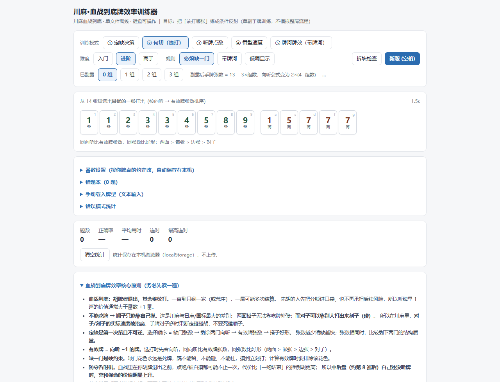

# 川麻牌效率训练器 + 血战到底 AI 对局


两部分，都是**零依赖**的原生 JS：

- **牌效训练器**（`index.html`）：离线，双击即用。
- **AI 对局**（`table.html`）：你和三家电脑打完整的血战到底，有实时局势分析，还可以接大模型讲解。见下文「AI 对局模式」。

训练器只训练**单副手牌决策**（定缺 / 何切 / 听牌 / 番型 / 牌河牌效），不模拟整局流程，也不绑定推倒胡或血战到底的结束规则；
向听、有效牌、定缺、好形这些牌理在两种规则下通用，番数 / 封顶 / 底分可按你牌桌的约定自定义。
训练器无框架、无构建、无网络请求，浏览器直接打开 `index.html` 即可。



## AI 对局模式（table.html）

```bash
npm start            # 等同于 node server.js，然后打开 http://127.0.0.1:5173/table.html
```

只用浏览器直连的服务商时，也可以用任意静态服务器打开 `table.html`。
它用的是 ES 模块，**不能**直接双击用 file:// 打开。

### 能做什么

| 功能 | 说明 |
|---|---|
| 完整对局 | 换三张（可关）→ 定缺 → 摸打 / 碰 / 直杠 / 暗杠 / 补杠 → 自摸 / 点炮 → 血战到底（胡者退出，其余继续） |
| 川麻规则 | 一炮多响、过手胡、抢杠胡、刮风下雨、呼叫转移；流局时查花猪、查大叫、退税。口径见 [docs/ai-table-design.md](docs/ai-table-design.md) |
| 电脑三档 | **入门**：向听优先，带随机失误，能碰就碰<br>**进阶**：向听 → 有效牌（扣除场上可见牌）<br>**高手**：进阶基础上再加一步前瞻（好形）和听牌质量（剩余张数 × 番数） |
| 局势分析 | 每次轮到你时由程序计算：候选打法的向听、有效牌、听牌张数和番数、危险度估计、综合分；对手的缺门、威胁估计、是否疑似清一色；关键时刻提醒 |
| 练习模式 | 出牌前隐藏推荐和综合分，打完再显示「你打的是第几名」 |
| AI 讲解 | 填 API key 后点「讲解这一手」，流式输出。关键时刻（听牌、可碰杠胡、对手威胁高、后巡、缺门未清）按钮会闪烁，也可以设为自动讲解 |

### 设计原则：引擎负责计算，大模型只负责讲解

通用大模型直接判断牌效很不可靠：[HF 的测评](https://huggingface.co/blog/sileixu/mahjong)给 13 张牌，让模型找出所有能胡的牌，
o1 正确率 31%，GPT-4o 不到 9%。开源川麻项目 [To-G/mahjong-ai](https://github.com/To-G/mahjong-ai)、
[gangzhao2021/Mahjong](https://github.com/gangzhao2021/Mahjong) 也都让规则引擎出牌，LLM 只做解说或对话。

所以本项目这样分工：

- 出牌全部由引擎和电脑 AI 决定。
- 分析器先把每个候选打法的数值算好，序列化成 JSON（牌名用「5万」这类写法）交给大模型。
- 系统提示要求模型只引用给定数据，并引用候选编号（c1、c2…）。
- 讲解返回后，程序会校验：讲解里提到的牌是否都出现在局面数据里，讲解的建议是否和程序推荐一致。不一致时给出提示。

架构上参考了 [Mortal](https://github.com/Equim-chan/Mortal)、mjai、[Akagi](https://github.com/shinkuan/Akagi) 的分层：

- 规则引擎是纯数据状态机，用同一个种子和同一串决策就能重放整局；
- `viewFor(seat)` 按座位隔离信息，电脑和分析器都看不到别家的手牌和牌墙；
- 所有变化写成事件流。

### 大模型服务商

| 服务商 | 浏览器直连 | 说明 |
|---|---|---|
| OpenAI | ✓ | `https://api.openai.com/v1` |
| DeepSeek | ✓ | `https://api.deepseek.com`，会显示 `reasoning_content` 思考过程 |
| OpenRouter | ✓ | `https://openrouter.ai/api/v1` |
| Moonshot (Kimi) | ✓ | `https://api.moonshot.cn/v1` |
| OpenCode Go | ✗ 必须走代理 | `https://opencode.ai/inference/go/openai/v1`，见下方注意事项 |
| 自定义 | 可选 | 任意 OpenAI 兼容地址；需要代理时，启动前设置 `LLM_PROXY_ALLOW=https://你的地址/v1` |

「浏览器直连」一列是 2026-10 用 CORS 预检实测的结果。模型名可以点「获取模型」从 `/models` 拉取，也可以手填。

> **OpenCode Go 注意**：官方文档说它是为 OpenCode 和其他编码 agent 设计的，并且会监控滥用流量。
> 麻将讲解不是典型的编码流量，有被判定为滥用的风险，请自行评估。
> 本项目的代理会如实用 `mahjong-trainer/版本号` 作为 UA，按要求附带 `x-opencode-session`，**不会**伪装成编码 agent。

**API key 安全**：

- 默认只存在 sessionStorage，关闭页面就清除；勾选「记住」才会写入 localStorage。
- 页面直接把请求发给服务商，或者发给本机的 `server.js`，不经过任何第三方。
- 建议使用有额度上限的 key。

本地代理 `server.js` 的安全措施：

- 只监听 127.0.0.1；
- 只接受本页面的同源请求，并校验 Host 头，防止 DNS 重绑定；
- 转发目标走白名单；
- 静态文件只对外提供 `index.html`、`table.html`、`src/`、`docs/`。

### 电脑难度实测（复式自对弈）

测法：同一副牌，两种难度隔座坐（A B A B），打完后双方换座位再打一次（复式），用来抵消牌运。
表中「优势」是双方平均每座每局得分之差，括号里是 95% 置信区间；底分 1，3 番封顶。

| 对比 | 副牌数 | 优势（分 / 座 / 局） |
|---|---|---|
| 进阶 vs 入门 | 400 | **+2.66** ± 0.39 |
| 高手 vs 入门 | 400 | **+2.87** ± 0.40 |
| 高手 vs 进阶 | 1000 | **+0.24** ± 0.17 |

调优过程中，危险度防守（攻守兼顾 / 弃和）在这个对手池里**没有**带来收益（+0.02 ± 0.11），所以高手默认不开防守。
分析面板仍会显示危险度和对手威胁，但它们是启发式估计，只作参考。


## 怎么开始（30 秒）

双击 `index.html` 即可。不需要安装、不需要联网、不需要登录、没有音效。

> 在公司用：`低调显示` 按钮会把界面切成 `4s / 3m / 7p` 的字母记法，标题也变成 `Sequence Drill`，
> 看起来就是一个普通的数据/组合工具页面。全部用键盘操作，最小化窗口也不会响。

快捷键：

| 键 | 作用 |
|---|---|
| `1`~`9` `A`~`G` | 选择对应的手牌（牌角上有提示） |
| `1` `2` `3` | 定缺模式下选择 万 / 条 / 筒 |
| `0`~`9` | 番型模式下选择番数（按钮数量随封顶值变化） |
| `Enter` | 听牌模式提交答案 |
| `空格` | 换下一题（并取消手动载入） |

## 核心公式（先背这 8 个字）

```
向听 = 8 − 2×面子 − 搭子 − 将
```

- **面子** = 刻子或顺子 → 每个算 **2 分**
- **搭子** = 差 1 张就成面子的 2 张（两面/嵌张/边张/对子）→ 每个算 **1 分**
- **将** = 有对子当雀头 → **1 分**，没有 → 0 分
- 约束：**面子 + 搭子 ≤ 4**；**同一张牌只能用一次**

验证：4面子+1将 → `8−8−0−1 = −1`（和牌）；3面子+1搭子+1将 → `0`（听牌）；2面子+2搭子+1将 → `1`。

对子 ≥ 5 时改走七对：**七对向听 = 6 − 已有对数**。

## 五种训练模式

| 模式 | 练什么 | 说明 |
|---|---|---|
| **① 定缺决策** | 全局最重要的**不可逆**决策 | 13 张三门，选该丢哪门。判定顺序 = 缺门张数 → 剩余两门向听 → 有效牌张数 → 搭子好形 |
| **② 何切（选打）** | **最核心**，值得 80% 的训练时间 | 14 张选打哪张。按 向听 → 有效牌张数 排序 |
| **③ 听牌点数** | 数听牌 / 有效牌的敏感度 | 13 张听牌型，填听牌种类数。可指定「听 1/2/3 种」专项练 |
| **④ 番型速算** | 一眼算出这副牌几番 | 给一副已和的手牌 + 自摸/点炮，选番数；会出现 4 组副露 + 一对的金钩钓题 |
| **⑤ 牌河牌效（带牌河）** | 把场上已出的牌从有效牌里扣掉 | 带牌河的何切题，有效牌已扣减；**不含**对手听牌/危险度模型 |

可选开关：`必须缺一门` / `带牌河` / `已副露 0~3 组` / `低调显示`。

> **副露**：选 n 组后，手牌张数自动变成 `13 − 3n`（何切模式发 `14 − 3n` 张），
> 向听公式也相应变成 `2×(4−n) − 2×面子 − 搭子 − 将`。

答完题会显示**多段详细解析**：

1. **先给这手牌拆块** —— 面子 / 搭子 / 将 / 孤张，并代入公式
2. **正解打完之后** —— 拆块 + 公式 + 有效牌
3. **你选的那张之后** —— 同样拆块，直接对比差在哪（答对时不显示）
4. **全部打法对比表** —— 每种打法的 向听 / 有效牌 / 面·搭·将 / 剩下孤张
5. **留下的孤张各自还能配什么** —— 孤张的价值不看长相，看它还能配几张牌
6. **关键提示** —— 自动指出“拆面子掉向听”和“有效牌多但向听差”的陷阱

## 四个工具面板

| 面板 | 作用 |
|---|---|
| **番数设置** | 16 项番型的番数 + 封顶 + 底分，**按你牌桌的约定改**，存在本机 |
| **错题本** | 答错的题自动存入，支持重做 / 删除 / 导出 JSON / 导入 / 跨设备分享 |
| **手动载入牌型** | 支持 `w1234t5678s123` 和 `123456789m111m22m` 两种写法。13 张出听牌题，14 张出何切题 |
| **错误模式统计** | 统计你常犯的错误类型（拆面子、选少有效牌、忽略牌河、定缺、听牌、番型） |

### 拆块检查（答题前用）

工具栏的 **`拆块检查`** 按钮会把手牌拆成 `面子 / 搭子 / 将 / 孤张` 并代入公式，
**只显示结构、不给答案** —— 让你先自己拆，再对照。


推荐用法：看到题先在纸上写 `面子__ 搭子__ 将__ → 向听__`，再点「拆块检查」对答案。

## 推荐的每日 10 分钟训练法

刻意练习的核心是：**窄化技能 → 即时反馈 → 重复 → 逐步加难**。所以不要"打牌"，要"练题"。

| 时间 | 内容 | 要求 |
|---|---|---|
| 0–3 分 | 模式② 何切 × 10 题 | 每题压在 **8 秒**内，不要纠结；答错立刻看复盘表并在心里说出理由 |
| 3–5 分 | 模式③ 听牌点数 × 5 题 | 练"一眼看出听几张" |
| 5–7 分 | 模式① 定缺 × 5 题 | 培养第一感 |
| 7–10 分 | **实体复盘** | 打完一把真牌，**只挑 2–3 个当时犹豫过的决策点**写下：当时想什么 / 现在觉得该怎样 |

**关键纪律：只复盘关键决策，不复盘整局。** 逐巡复盘会淹没真正的错误模式。
正确率稳定在 85% 以上后，把难度推到 **高手**（不再"送分"，会出现多个都说得通的打法）。

---

## 研究结论：川麻牌效率的技巧重点，和网上大部分"麻将技巧"不一样

### 1. 中文互联网上的"麻将技巧"基本不可用

搜索到的绝大多数内容是「口诀」「顺口溜」「牌浪」「手气」「宁可拆搭不打危险张」这类
**不可证伪的经验之谈**，既没有量化，也不区分规则变体。

真正严谨、可迁移、有大量实证的麻将理论体系是**日式立直麻将的「牌效率 / 何切る」研究**
（五块理论、向听数、有效牌、好形/愚形）。筒条万部分的牌理 **100% 通用**，
但必须针对川麻的规则差异做三处校正。

### 2. 规则差异（这三条决定了川麻该怎么打）

| 差异 | 其他麻将 | 川麻（推倒胡 / 血战到底） | 带来的打法结论 |
|---|---|---|---|
| **能不能吃** | 可以吃上家 | **不能吃**，只能碰/杠 | **顺子只能靠自己摸，对子却能靠别人打出来刻子（碰）。** 对子的实际速度被抬高 → 手牌对子多时果断转碰碰胡，不要死磕顺子 |
| **结束条件** | 各家规则不同 | **推倒胡**：一家胡牌结束；**血战到底**：胡者退出、其余继续 | 本训练器不区分这两种规则，只练单副手牌：早听早胡在两种规则下都是第一原则 |
| **缺一门** | 无 | **硬约束**，多数玩法还要求**定缺**（不可更改） | 缺门花色永远是死牌；定缺是全局最大且不可逆的一次决策 |

### 3. 所以第一原则是：**早听 > 大牌**

粗算一下牌墙就明白了：

- 总牌 108 张，4 家各 13 张（庄家 14）= 约 53 张，**牌墙只剩约 55 张**
- 每人平均只有 **13~14 巡**摸牌机会，**多数牌局在前 7~9 巡就有人胡了**
- 做清一色要 10 巡以上 → 大概率在你听牌前，别人已经胡了

**量化结论**：为了多做 1 番而晚听 3 巡，期望值通常是负的。
先胡的人在两种规则下都占优（血战里先胡还能先把分锁进口袋、不再承担后续风险）；只有当你**已经听牌**、
或**向听数与有效牌都接近**时，才去比较番型。

### 4. 定缺怎么选

> 判定顺序：**① 缺门张数 → ② 剩余两门向听 → ③ 有效牌张数 → ④ 搭子好形**。

- **清缺速度**：缺门在手张数越少，越早打完、越早进入正常摸打
- **剩余牌效**：打完缺门后，剩下两门的向听数越低越好
- **有效牌张数**：剩余两门里能降向听的牌一共几张（已扣手上持有的）
- **搭子质量**：两面 > 对子 > 嵌张 > 边张

注意：定缺后不能改，整局摸到缺门牌必须立刻打出，不能留、不能碰、不能杠。
训练器的「定缺决策」正是按这四项排序给参考的（题后对照表会标出哪一项决定了推荐）。
难度也按这个顺序分层：**入门 = 比张数，进阶 = 比向听，高手 = 比有效牌/好形**。

### 5. 何切（选打）的判定顺序

1. **先看向听**：打出后向听数最小
2. **同向听比有效牌张数**：能让你少一向听的牌，一共还剩几张（要扣掉手上已持有的）
3. **同张数比好形**：两面 > 嵌张 > 边张 > 对子
4. **只有前三项都打平时，才去比番型**

### 6. 防守：中后盘才重要

点炮/被自摸的期望代价通常明显高于多做 1 番的收益；
且自摸一般加倍、三家都赔，所以**防自摸的价值高于防点炮**。
（血战规则下你在胡牌退出前可能不止一次点炮/被自摸，代价还会叠加。）

实务上：**大约第 8 巡之后自己还没听牌，弃和保命的价值明显上升**。
而如果你的听牌率能稳定在 80% 以上，你的胜率就已经很高了——**优先练进攻，而不是练防守**。

> 训练器的「牌河牌效」模式目前只做**牌河扣减**（把已见的牌从有效牌里去掉），
> 还没有对手听牌/危险度的放炮风险模型——所以它不叫"防守"。

### 7. 其他容易忽略的

- **荒庄前最后四张能胡必须胡**，别为了做大牌放过终局附近的胡牌机会。
- **杠是低风险收益**：明杠/暗杠立即进账，杠上开花还加番，早中盘的杠基本没有理由不杠。
- **抢杠胡由补杠者一家赔（按点炮计，+1 番）**，所以补杠前要留意别人是不是在听这张牌。

---

## 番数表（默认值 = 你牌桌的约定）

| 番型 | 番数 | 番型 | 番数 |
|---|---|---|---|
| 平胡 | 0 | 全带么 | 2 |
| 对对胡 | **1** | 断么九 | 1 |
| 七对 | **2** | 金钩钓 | **2** |
| 龙七对 | **3** | 根（四归一） | 1 / 个 |
| 清一色 | 2 | 自摸 | **+1** |
| 杠上花 / 杠上炮 | 1 | 抢杠胡 | 1 |
| 海底捞月 | 1 | 封顶 | **3 番** |

**计分**：`得分 = 底分 × 2^番数`（封顶后）

口径说明：**龙七对 3 番已包含第一个四张（第一根）**。同一副七对里出现第二个四张时才再另计 1 个「根」
（例如双龙七对 = 3 + 1 = 4 番）；非七对牌型里的四张（含杠）每个都算 1 根。

口径说明 2：**金钩钓（2 番）已包含对对胡**。4 组副露 + 手里一对只按金钩钓计，不再叠 1 番对对胡。

这些值都可以在界面的「番数设置」里改，自动存在本机。

## 规则假设（重要）

不同牌桌的川麻规则在细节上会有出入。训练器默认按下列假设，可在界面上调整：

| 项目 | 默认 | 可调 |
|---|---|---|
| 牌张 | 万/条/筒各 36 张，共 108 张，无字牌 | — |
| 缺一门 | **必须缺一门**（何切模式下只发两门牌） | 界面「必须缺一门」按钮 |
| 吃牌 | 不可以吃 | — |
| 定缺 | 开局选一门，不可更改，摸到必须打出 | — |
| 胡牌型 | 4 面子 + 1 将；七对 / 龙七对 / 对对胡 / 清一色 | — |
| 副露 | 可碰、可杠（何切/听牌/牌河牌效 0~3 组）；番型速算会出现 4 组副露的金钩钓题 | 界面「已副露」按钮 |
| 番数 | 见上表 | 界面「番数设置」面板 |

> **训练器（index.html）只训练单副手牌决策**（定缺 / 何切 / 听牌 / 番型 / 牌河牌效），**不模拟整局流程**。
> 推倒胡 / 血战到底的结束规则、多家胡牌、查大叫 / 查花猪、一炮多响、换三张等都不在范围内——
> 训练器只负责把每一副手牌该做的决策练成本能；整局规则在 **AI 对局模式**里实现。

## 参考的开源项目

规则与算法层参考了以下项目的公开实现（仅参考规则，未引入任何代码）：

| 项目 | 参考了什么 |
|---|---|
| `moff1022-git/chengdu_majiang_AItrainer` | **番型表**（`configs/fan_table.json`）和**计分参数**。它的番数表与维基百科「成都计番」完全一致 |
| 同上 | **向听公式**：`2×(4−面子) − 搭子 − 将`；**定缺处理**：缺门牌清零后 `向听 + 缺门张数` —— 本训练器早期采用该近似，现已升级为多目标排序（张数 → 剩余向听 → 有效牌 → 搭子好形） |
| 同上 | **和牌约束**：不允许吃牌、定缺是硬约束 |
| `liuminxin45/ai-mahjong` | 龙七对 = 3 番；可解释 AI 的特征维度（向听/进张/危险度）；**错误模式检测**的思路 |
| `liuminxin45/ai-mahjong` | **定缺校验**：手中仍有缺门牌时必须先打完缺门牌 |
| `kevin-chen-2022/mahjong-queyimen` | **N 面听牌生成**、**错题本（牌组库）**、**文本输入格式** `w1234t5678s123` |

以下项目经核查**未采纳**：

- `lmxdwn/chengdu-mahjong` —— **仓库不存在（404）**，引用无效
- `zengyangjie/AI-Mahjong` —— README 为空，YOLO 识牌科研项目，无规则价值
- `getouthh/cdxzmj` —— VS2010 老工程，只有三个中文目录，无规则文档
- `datamllab/rlcard` —— 通用 RL 卡牌库，**不含成都麻将规则**

## 算法与自检

向听数采用标准的「4 面子 + 1 雀头」递归分解（`shantenStd`），七对按**川麻定义**单独计算
（4 张同牌算两对，即龙七对，等价于 `6 − 总对数`）。

拆块展示用 `decompose()`：同样搜索最优的 `面子/搭子/将` 组合，
优先级为「向听最小 → 面子最多 → 孤张最少」。

番型识别用 `detectYaku()`（龙七对含第一根、金钩钓含对对胡），和牌判定用 `isWinHand()`（支持副露：`need = 4 − 副露数`，4 组副露时只认将牌）。
定缺评分用 `voidEval()`：缺门张数 → 剩余两门向听 → 有效牌张数 → 搭子好形。

跑自检（无需安装依赖，Node ≥ 18）：

```bash
npm test                      # 一键跑下面全部
node tools/test-core.js       # 24 项：已知牌型、性质、出题器、定缺多目标评分、性能
node tools/verify-shanten.js  # 用「距离定义」的独立实现做交叉验证（300 组随机牌）
node tools/test-fan.js        # 58 项：和牌判定、番型识别、计分、文本解析、副露向听、牌河扣减、出题器
node --test tests/engine.test.mjs   # 对局引擎：换三张、定缺、碰杠、一炮多响、呼叫转移、抢杠、过手胡、流局结算、300 局不变量
node --test tests/bots.test.mjs     # 电脑合法性、难度回归（复式）、分析器、危险度
node --test tests/llm.test.mjs      # SSE 解析、流式客户端、提示词、讲解校验、本地代理安全
```

自检覆盖：已知牌型取值、与独立实现的**和牌判定一致性**（4000 组随机牌）、
加牌单调性、向听递进性、听牌列表与暴力枚举的一致性、缺一门约束、三种出题器的稳定性与耗时。

## 文件

```
mahjong-trainer/
├── index.html            # 牌效训练器（双击即用）
├── table.html            # AI 对局页面
├── server.js             # 零依赖本地服务：静态文件 + LLM 代理
├── package.json          # npm start / npm test（无任何依赖）
├── src/
│   ├── core/mj-core.js   # 向听 / 有效牌 / 和牌 / 番型 / 计分（训练器与对局共用）
│   ├── core/core.mjs     # 上面的 ES 模块入口
│   ├── game/             # 对局引擎（engine）、规则默认值（rules）、种子随机数（rng）
│   ├── ai/               # 电脑（bots）、局势分析（analyzer）、危险度（danger）
│   ├── llm/              # 服务商、流式客户端、提示词与讲解校验
│   └── ui/table.mjs      # 对局界面
├── tests/                # node:test 测试（引擎 / 电脑 / LLM）
├── docs/ai-table-design.md  # AI 对局设计与规则口径（含每条规则的出处）
├── docs/screenshot.png   # 界面预览
├── .github/workflows/    # GitHub Actions：Node 18/20/22 跑自检
└── tools/
    ├── test-core.js      # 向听 / 定缺 / 出题器自检
    ├── test-fan.js       # 和牌判定 / 番型 / 计分 / 文本 / 副露 / 牌河 自检
    └── verify-shanten.js # 向听的独立实现交叉验证
```

## 许可

[MIT](LICENSE) © 2026 TangFan
